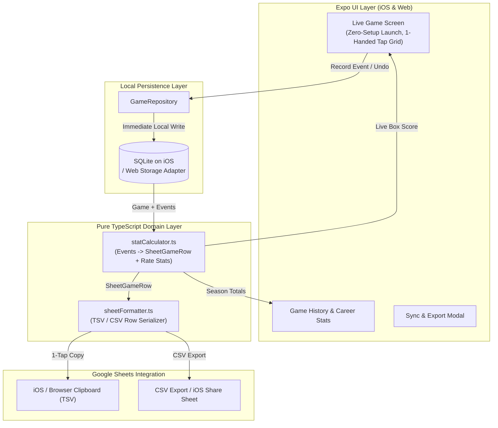

# Baseball Box Score — iOS App Architecture

## 1. Context & Design Principles

This application replaces a manual workflow of logging live in-game personal baseball statistics in Apple Notes and later transcribing them into a Google Sheets "database".

### Core Architectural Constraints
1. **Local-First & Offline-Resilient**: Dugouts frequently have weak or no cellular connectivity. All game creation, event logging, undo/redo, and stat calculation happen 100% locally on the device with immediate persistence (`<2ms` write latency) and zero required backend or user authentication.
2. **Zero-Friction Live Game UX**: Launching the app drops directly into an active game session with sensible defaults (`Date = Today`, `Position = last used position`) and zero required text fields before logging the first plate appearance or fielding play.
3. **Sync With Google Sheets (Not Replace It)**: The app acts as a fast, reliable capture tool and pocket stat reference that outputs rows matching the existing 23-column Google Sheet schema (via 1-tap TSV clipboard copy and CSV export).
4. **WSL Ubuntu + Windows -> iPhone Development Workflow**: Built with **React Native (Expo) + TypeScript** so the entire application can be developed and tested inside WSL Ubuntu on a Windows laptop (via unit tests and mobile-viewport browser preview) and tested natively on a physical iPhone via **Expo Go** over Wi-Fi/tunnel without requiring macOS or Xcode.

---

## 2. Technology Stack & Trade-offs

| Layer | Selected Technology | Rationale | Alternatives Considered |
| :--- | :--- | :--- | :--- |
| **Mobile Framework** | **Expo (React Native) + Expo Router + TypeScript** | Runs natively on iOS via Expo Go directly from WSL Ubuntu (`npx expo start --tunnel`) and renders in a Windows desktop browser (`npx expo start --web`) for rapid local iteration. | *Swift/SwiftUI* (requires macOS + Xcode to build and simulate locally); *PWA* (weaker offline storage guarantees and native haptics on iOS). |
| **Local Database** | **SQLite (`expo-sqlite`) + Repository Abstraction** (with Web storage fallback) | Relational SQL database stored on-device. Enables instant transactional event logging, crash recovery, and multi-season/by-position historical queries. | *AsyncStorage* (key-value store only; awkward for relational event logs and multi-game aggregation); *Hosted Cloud DB* (unnecessary complexity and network dependency). |
| **State & Data Pattern** | **Append-Only Event Log + Derived Summary** | Each plate appearance or fielding play is persisted immediately as an immutable `GameEvent`. Box score totals and rate stats are pure derived functions of the event stream, making **Undo** and mid-game edits trivial. | *Mutable Counter Columns* (error-prone when correcting mistakes or tracking RBIs per plate appearance). |
| **Testing** | **Vitest / Jest** | Runs pure TypeScript unit and integration tests for baseball math, repository persistence, and Google Sheets row formatting in `<1s` inside WSL. | Manual-only testing. |
| **Google Sheets Integration** | **1-Tap TSV Row Copy (`expo-clipboard`) + CSV Share** | Tab-separated (`\t`) clipboard rows paste cleanly across all 23 columns in Google Sheets while leaving formula columns blank so `ARRAYFORMULA` columns calculate automatically. | *Full Google Cloud OAuth2 + Sheets REST API* or *Apps Script Webhook* (unnecessary setup overhead for a single-user personal app). |

---

## 3. Domain Model & Google Sheets Mapping

### 3.1 Google Sheet Column Schema (1 Row = 1 Game)

The target Google Sheet uses a 23-column layout combining game context, raw counting stats, and formula-calculated rate stats:

| Col # | Column Header | Source Type | Definition / Formula |
| :---: | :--- | :--- | :--- |
| **A (1)** | `Date` | Context | Game date (`YYYY-MM-DD` or localized sheet date format) |
| **B (2)** | `Position` | Context | Defensive/lineup position(s) played (e.g., `SS`, `CF`, `SS / 2B`) |
| **C (3)** | `AB` | Derived Count | $\text{1B} + \text{2B} + \text{3B} + \text{HR} + \text{E (Batting)} + \text{FC} + \text{K} + \text{FO} + \text{GO}$ |
| **D (4)** | `H` | Derived Count | $\text{1B} + \text{2B} + \text{3B} + \text{HR}$ |
| **E (5)** | `AVG` | Calculated Rate | $H / AB$ (`null` / `0.000` when $AB = 0$) |
| **F (6)** | `1B` | Batting Input | Singles |
| **G (7)** | `2B` | Batting Input | Doubles |
| **H (8)** | `3B` | Batting Input | Triples |
| **I (9)** | `HR` | Batting Input | Home Runs |
| **J (10)** | `E (Batting)` | Batting Input | Reached on Error (counts as an `AB`, not a Hit) |
| **K (11)** | `BB` | Batting Input | Walks / Bases on Balls (does **not** count as an `AB`) |
| **L (12)** | `OBP` | Calculated Rate | $(H + BB) / (AB + BB)$ *(configurable if sheet includes ROE)* |
| **M (13)** | `SLG` | Calculated Rate | $(\text{1B} + 2\cdot\text{2B} + 3\cdot\text{3B} + 4\cdot\text{HR}) / AB$ |
| **N (14)** | `OPS` | Calculated Rate | $\text{OBP} + \text{SLG}$ |
| **O (15)** | `RBI` | Batting Input | Runs Batted In (`0–4` attached to plate appearances) |
| **P (16)** | `FC` | Batting Input | Fielder's Choice (counts as an `AB`, not a Hit) |
| **Q (17)** | `K` | Batting Input | Strikeouts (counts as an `AB`, Out) |
| **R (18)** | `FO` | Batting Input | Fly Outs (including Line Outs / Pop Outs; counts as an `AB`, Out) |
| **S (19)** | `GO` | Batting Input | Ground Outs (counts as an `AB`, Out) |
| **T (20)** | `PO` | Fielding Input | Putouts |
| **U (21)** | `Assists` | Fielding Input | Fielding Assists |
| **V (22)** | `Errors` | Fielding Input | Fielding Errors |
| **W (23)** | `FLD PCT` | Calculated Rate | $(PO + \text{Assists}) / (PO + \text{Assists} + \text{Errors})$ |

### 3.2 Plate Appearance Outcome Rules

Users never manually increment `AB` or `H`. Tapping a single plate appearance outcome updates all dependent stats deterministically:

| Outcome Tap | Code | `AB` | `H` | Specific Column | Default / Allowed `RBI` |
| :--- | :--- | :---: | :---: | :--- | :--- |
| **Single** | `1B` | `+1` | `+1` | `1B + 1` | `0` (adjustable `0–4`) |
| **Double** | `2B` | `+1` | `+1` | `2B + 1` | `0` (adjustable `0–4`) |
| **Triple** | `3B` | `+1` | `+1` | `3B + 1` | `0` (adjustable `0–4`) |
| **Home Run** | `HR` | `+1` | `+1` | `HR + 1` | `1` (adjustable `1–4`) |
| **Reached on Error** | `E_BAT` | `+1` | `0` | `E (Batting) + 1` | `0` (adjustable `0–4`) |
| **Fielder's Choice** | `FC` | `+1` | `0` | `FC + 1` | `0` (adjustable `0–4`) |
| **Strikeout** | `K` | `+1` | `0` | `K + 1` | `0` |
| **Fly Out (Fly/Line/Pop)** | `FO` | `+1` | `0` | `FO + 1` | `0` (adjustable `0–1` for sac/productive out) |
| **Ground Out** | `GO` | `+1` | `0` | `GO + 1` | `0` (adjustable `0–1` for productive groundout) |
| **Walk (Base on Balls)** | `BB` | `0` | `0` | `BB + 1` | `0` (adjustable `0–1` if bases loaded) |

---

## 4. Database Schema & TypeScript Contracts

### 4.1 Local SQLite Schema

```sql
-- Games table: stores metadata and sync status per game
CREATE TABLE IF NOT EXISTS games (
    id TEXT PRIMARY KEY NOT NULL,                  -- UUID v4
    game_date TEXT NOT NULL,                       -- YYYY-MM-DD (defaults to today)
    position TEXT NOT NULL DEFAULT 'UTL',          -- e.g. 'SS', 'CF', 'SS / 2B'
    opponent TEXT NOT NULL DEFAULT '',             -- Optional opponent name
    notes TEXT NOT NULL DEFAULT '',                -- Optional game notes
    status TEXT NOT NULL DEFAULT 'active',         -- 'active' | 'completed'
    synced_to_sheets INTEGER NOT NULL DEFAULT 0,   -- 0 = unsynced, 1 = synced
    synced_at TEXT,                                -- ISO timestamp of last sync
    created_at TEXT NOT NULL,
    updated_at TEXT NOT NULL
);

-- Game Events table: append-only log of batting and fielding plays
CREATE TABLE IF NOT EXISTS game_events (
    id TEXT PRIMARY KEY NOT NULL,                  -- UUID v4
    game_id TEXT NOT NULL,
    sequence_num INTEGER NOT NULL,                 -- Monotonically increasing per game (1, 2, 3...)
    category TEXT NOT NULL,                        -- 'batting' | 'fielding'
    event_type TEXT NOT NULL,                      -- BattingOutcome | FieldingOutcome
    rbi INTEGER NOT NULL DEFAULT 0,                -- 0 to 4
    inning INTEGER,                                -- Optional inning number
    position_at_event TEXT,                        -- Active position when recorded
    created_at TEXT NOT NULL,
    FOREIGN KEY (game_id) REFERENCES games(id) ON DELETE CASCADE
);

CREATE INDEX IF NOT EXISTS idx_game_events_game_seq
    ON game_events(game_id, sequence_num);
```

### 4.2 Core TypeScript Interfaces (`src/domain/types.ts`)

```typescript
export type BattingOutcome =
  | '1B'
  | '2B'
  | '3B'
  | 'HR'
  | 'E_BAT'
  | 'BB'
  | 'FC'
  | 'K'
  | 'FO'
  | 'GO';

export type FieldingOutcome = 'PO' | 'ASSIST' | 'E_FLD';

export type EventCategory = 'batting' | 'fielding';

export interface Game {
  id: string;
  gameDate: string;          // YYYY-MM-DD
  position: string;          // e.g. 'SS', 'CF'
  opponent: string;
  notes: string;
  status: 'active' | 'completed';
  syncedToSheets: boolean;
  syncedAt: string | null;
  createdAt: string;
  updatedAt: string;
}

export interface GameEvent {
  id: string;
  gameId: string;
  sequenceNum: number;
  category: EventCategory;
  eventType: BattingOutcome | FieldingOutcome;
  rbi: number;
  inning?: number | null;
  positionAtEvent?: string | null;
  createdAt: string;
}

export interface SheetGameRow {
  date: string;              // Col A: Date
  position: string;          // Col B: Position
  ab: number;                // Col C: AB
  h: number;                 // Col D: H
  avg: number | null;        // Col E: AVG (calculated)
  singles: number;           // Col F: 1B
  doubles: number;           // Col G: 2B
  triples: number;           // Col H: 3B
  hr: number;                // Col I: HR
  eBatting: number;          // Col J: E (Batting)
  bb: number;                // Col K: BB
  obp: number | null;        // Col L: OBP (calculated)
  slg: number | null;        // Col M: SLG (calculated)
  ops: number | null;        // Col N: OPS (calculated)
  rbi: number;               // Col O: RBI
  fc: number;                // Col P: FC
  k: number;                 // Col Q: K
  fo: number;               // Col R: FO (Fly Outs / Line Outs)
  go: number;               // Col S: GO (Ground Outs)
  po: number;               // Col T: PO
  assists: number;          // Col U: Assists
  errors: number;           // Col V: Errors
  fldPct: number | null;    // Col W: FLD PCT (calculated)
}
```

---

## 5. System Components & Data Flow



### Recommended Directory Structure

```text
baseball-box-score/
├── app/                          # Expo Router screens
│   ├── _layout.tsx               # Bottom tab navigation (Live Game, History, Career, Settings)
│   ├── index.tsx                 # Live Game Dugout Screen (default launch screen)
│   ├── summary.tsx               # Game Box Score Summary & Data Sync screen
│   ├── history.tsx               # Past Games list & sync status
│   ├── career.tsx                # Cumulative season/career stats dashboard
│   └── settings.tsx              # Default position & full CSV backup
├── src/
│   ├── domain/                   # Pure TypeScript business logic (0 UI/DB dependencies)
│   │   ├── types.ts              # Domain & Google Sheet row types
│   │   ├── statCalculator.ts     # Event stream -> 23-column SheetGameRow & rate math
│   │   ├── sheetFormatter.ts     # TSV and CSV serializers
│   │   └── liveGameHelpers.ts    # Box score summary formatting, date & season filter helpers
│   ├── storage/                  # Local-first persistence
│   │   ├── database.ts           # Platform-aware SQLite / Web storage initialization
│   │   ├── gameRepository.ts     # CRUD + event append/undo operations
│   │   └── preferencesStore.ts   # Default starting position preference store
│   ├── services/
│   │   ├── sheetsSyncService.ts  # Clipboard copy and CSV file export/share
│   │   └── hapticsService.ts     # Native iOS haptic feedback wrapper
│   └── components/               # Reusable high-contrast dugout UI components
│       ├── BottomNavBar.tsx
│       ├── LiveScoreStrip.tsx
│       ├── BattingPad.tsx
│       ├── FieldingPad.tsx
│       ├── EventTimeline.tsx
│       └── SheetRowPreview.tsx
└── tests/                        # Unit & integration tests (run directly in WSL)
    ├── statCalculator.test.ts
    ├── sheetFormatter.test.ts
    ├── liveGameHelpers.test.ts
    ├── gameRepository.test.ts
    └── sheetsSyncService.test.ts
```

---

## 6. Google Sheets Formula Preservation Strategy

Because the user's Google Sheet contains calculated rate columns (`AVG`, `OBP`, `SLG`, `OPS`, `FLD PCT`) interleaved between raw input columns (`D` and `F`, `K` and `O`, `V` and `W`), `sheetFormatter.ts` supports two configurable output modes for those 5 columns:

1. **`blank_for_arrayformula` (Default for TSV Copy & CSV Backup):** Outputs an empty value `""` in columns `E`, `L`, `M`, `N`, and `W` so sheet-level `ARRAYFORMULA` columns calculate automatically without being blocked by static text.
2. **`computed_values`:** Outputs formatted rate strings (e.g., `0.333`, `0.400`, `0.667`, `1.067`, `1.000`).
